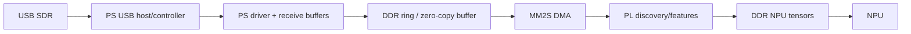
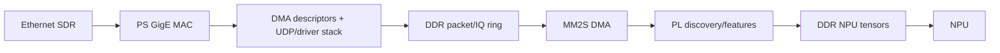
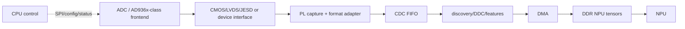

# SDR to FMQL30TAI transport feasibility

For signed int16 I plus signed int16 Q, every complex sample is 32 bits:

| Complex sample rate | Raw bit rate | Raw byte rate | 1.5× engineering target |
|---:|---:|---:|---:|
| 5 MS/s | 160 Mbit/s | 20 MB/s | 30 MB/s |
| 10 MS/s | 320 Mbit/s | 40 MB/s | 60 MB/s |
| 20 MS/s | 640 Mbit/s | 80 MB/s | 120 MB/s |

The 1.5× column is a procurement target for sustained payload capacity after
packet headers, host-controller scheduling, DMA descriptors, memory copies,
interrupts and concurrent NPU/display traffic. It is not a measured result.

## A. USB SDR

USB 2.0 High-Speed has a nominal 480 Mbit/s/60 MB/s line rate. It is suitable
for 5 MS/s only after sustained-driver testing; 10 MS/s is marginal and cannot
meet the 1.5× target; 20 MS/s exceeds the nominal line rate. USB 3.x 5 Gbit/s
class links have ample nominal line rate for 20 MS/s, but only if the board is a
USB host, the SDR supports that rate, the ARM driver exists, and sustained
USB→DDR throughput exceeds 120 MB/s without drops.

The PS necessarily participates in USB transport and buffer ownership. CPU
copying may be reduced by DMA/zero-copy, but CPU cannot be described as
control-only unless the actual USB driver proves a no-copy hardware path.

## B. Ethernet SDR

1 Gigabit Ethernet has a nominal 125 MB/s line rate. 5 and 10 MS/s have useful
headroom. Raw 20 MS/s consumes 80 MB/s, and the 120 MB/s engineering target is
too close to the line rate once Ethernet/IP/UDP framing, gaps, packet loss and
memory contention are included. Treat 20 MS/s over 1GbE as conditional, not
guaranteed. A faster Ethernet link or a compressed/lower-bit IQ format provides
more margin, but changes the procurement and numerical contract.

With a PS-terminated MAC/network stack, PS software participates in IQ
transport. A direct PL Ethernet MAC→DMA architecture could make CPU mostly
control-only, but it is a different design that must be supported by board IO,
IP licensing and SDR packet protocol.

## C. Direct digital RF frontend

The PL pins/lanes must carry at least 160/320/640 Mbit/s of IQ payload for
5/10/20 MS/s, before interface encoding or multiplexing overhead. In this path
the CPU can be control-only: it configures RF registers, DMA descriptors and
NPU jobs while samples stay in PL/DDR data planes. Exact lane count and clock
depend on the selected converter mode and cannot be assumed before schematic,
pin-bank and timing review.

## Procurement hard constraints

- Sustained complex sample rate and actual delivered IQ bit width/layout.
- At least 1.5× end-to-end payload headroom to DDR, measured for minutes without
  overflow or packet loss—not connector nominal speed.
- FMQL30TAI BSP support for USB host or Ethernet receive drivers on the target
  OS, including ARM architecture support for the SDR API.
- Timestamp, dropped-packet indication, buffer alignment and deterministic
  start/stop behavior.
- Direct-front-end voltage standard, lane count, clock direction/jitter,
  reference-clock and trigger IO, FPGA bank compatibility and available pins.
- RF bandwidth, tuner range, gain-control behavior, full-scale definition,
  oscillator accuracy and external clock support.
- Ability to expose or freeze AGC/gain so ADC counts map reproducibly to model
  units.
- DDR bandwidth shared by ingress, PL, NPU and display; cache coherency and
  zero-copy capability.

No final SDR is selected by this analysis.
