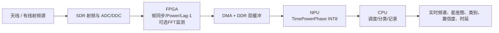

# 基于 FPGA-NPU 异构架构的智能无线电频谱感知与调制识别系统

## 作品定位

系统面向复杂电磁环境中的宽带频谱感知和自动调制识别。SDR 完成射频
收发与数字 IQ 采样，FPGA 负责确定性实时流处理和物理特征生成，NPU 负责
轻量神经网络推理，CPU 负责任务调度、结果融合、记录和可视化。

当前可复现实验候选为 TimePowerPhase：8 类调制、输入 1024 点 IQ、约
71.7K 参数、development_test Accuracy 70.55%。这一结果来自合成信道，
不能作为真实 SDR 或硬件性能结论。

## 总体架构

## 可讲清楚、可验证的创新点

1. **物理先验与学习特征协同。** FPGA 显式生成无平方根 Power 与无角度
   运算 Lag-1 复相关，NPU 同时编码原始 IQ 和物理特征。
2. **按部署边界设计模型。** 物理前端只有乘加、移位和饱和，神经网络只
   使用常见 Conv1D/Linear/ReLU/pooling 算子，适合 FPGA-NPU 分区。
3. **严格公平的科研评价。** Baseline、参数量匹配对照、双域和 QAM-aware
   模型共享数据分布、信道、split 与 seed；保留尚未开启的最终盲测集。
4. **软件 Golden Reference 驱动硬件验证。** 浮点、定点、RTL 仿真、板级
   tensor dump 和 NPU logits 逐级对齐，不用单个最终 Accuracy 掩盖接口错误。
5. **可解释的失败分析。** 已确认当前收益集中于高 SNR 16QAM，同时保留
   64QAM 反向混淆问题，后续优化目标可被明确度量。

## 算法路线

1. 冻结 TimeOnlyWide 和 TimePowerPhase 作为硬件前后的回归基线。
2. 保持 `IQ[2,1024]`，FPGA 生成 `Power/LagRe/LagIm[3,1024]`。
3. 在训练/验证数据上完成 INT8 标定；先 PTQ，必要时才申请结构不变的 QAT。
4. 用 development_test 对量化损失做一次固定评价，最终选择确定后才申请
   开启 final blind。
5. 若需要唯一一次轻量算法迭代，优先 8/16 bin 归一化功率直方图，而不是
   attention、Transformer 或第三大分支。

## FPGA 实现路线

1. SDR adapter 与 AXI4-Stream 异步 FIFO。
2. 1024 点帧控制、时间戳和 ping-pong 缓冲。
3. Power/Lag-1 定点流水线及饱和计数。
4. 与 Python 参考逐点验证后接入 AXI DMA/DDR。
5. 可选 FFT/PSD/能量检测只服务监测和 UI，初版不进入模型。
6. 有板后依次报告综合资源、Fmax、DMA 吞吐、帧丢失、功耗和稳定性。

## NPU 部署路线

1. 导出 opset 17 的端到端图和 FPGA 分区图。
2. 用板载准确版本 Icraft 做算子审计、图优化和 FP32/FP16 基线编译。
3. 建立均衡校准集，完成 INT8 PTQ、定点尺度同步和 tensor dump 对齐。
4. CPU 使用固定双缓冲队列提交 batch-1 推理，输出 8 logits。
5. 分别记录纯 NPU 推理、DMA、端到端和帧采集时延，禁止混为一个数字。

## SDR 测试方案

1. **数字回放：** 将固定 IQ 向量送入 PL，验证逐点特征和 logits。
2. **有线闭环：** SDR 发射端经合适衰减器接收，逐级扫描调制、SNR、CFO、
   采样率偏差和功率。禁止把高功率发射口直接接收。
3. **信道扩展：** 加入多径、衰落、IQ 不平衡、DC、干扰和削顶，测量
   Sim-to-Real gap；任何采集数据按设备/日期/session 分组防止泄漏。
4. **受控 OTA：** 在法规允许的频段、功率和测试环境进行；优先屏蔽箱或
   许可实验室，记录中心频率、带宽、距离、天线和环境。
5. **系统指标：** Accuracy/Macro-F1/SNR 曲线、QAM 双向混淆、采集/PL/DMA/
   NPU/总时延、records/s、资源、功耗、温度、丢帧和连续运行时间。

## 比赛展示方案

- 左侧实时显示瀑布图、PSD、I/Q 波形和星座图。
- 中部显示 FPGA 当前帧 ID、Power/Lag 特征摘要、FIFO/DMA/饱和状态。
- 右侧显示 8 类概率、最终类别、置信度、端到端时延和吞吐。
- 现场切换 BPSK/QPSK/8PSK/16QAM/64QAM/2FSK/CPFSK/OFDM，并通过衰减或
  软件信道展示 SNR 下降时性能拐点。
- 演示“关闭/开启物理特征”的冻结对照结果，解释为何 FPGA 不是单纯数据
  搬运，而是参与可验证的物理特征计算。
- 准备离线回放模式，避免现场射频环境或设备故障导致演示中断。

## 阶段门槛

当前阶段只完成架构、接口和导出审计。后续只有在以下门槛逐项通过后，
才能宣称系统落地：RTL bit-exact、DMA loopback、Icraft 无隐式回退、INT8
精度达标、真实 SDR 可复现、板级时延/资源/功耗实测、长稳无丢帧。

所有未实测项目统一标记 `TODO-HARDWARE`，不以 PC 结果替代 FPGA/NPU 指标。
