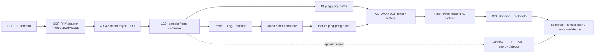

# FPGA data-path design for TimePowerPhase

## System flow

The exact SDR electrical interface is intentionally left behind
`sdr_rx_adapter`. The first board version converts whatever the selected SDR
provides into one internal contract: one signed int16 I/Q pair per AXI stream
beat, with explicit frame metadata.

## Stream and storage contract

- Input `s_axis_iq_tdata[31:0] = {Q[15:0], I[15:0]}`.
- `tvalid/tready` provide backpressure; `tlast` marks sample 1023.
- `tuser` carries start-of-frame, frame ID, overflow/error and optional
  timestamp association.
- One raw IQ frame occupies 4096 bytes.
- Exact Power/Lag storage is 98 bits/sample, or 12.25 KiB/frame. The preferred
  path computes it in a stream and stores only the quantized NPU tensor
  (3 KiB/frame for INT8), avoiding a large full-precision BRAM.
- IQ plus physical INT8 tensors occupy 5 KiB/frame. At the reference 128
  ksample/s with non-overlapping frames this is about 0.64 MB/s; 50% overlap is
  about 1.28 MB/s. These are calculated interface rates, not measured rates.

Use ping-pong buffers A/B: while DMA/NPU consumes frame A, FPGA fills frame B.
Small asynchronous FIFOs absorb clock drift; BRAM holds the current/next frame
and metadata; DDR holds NPU-visible tensors and output logits.

## Arithmetic path

For signed Q1.15 I/Q:

- `Power = I*I + Q*Q`: two 16x16 products plus one addition. Preserve 32
  unsigned bits before quantization.
- `CorrRe = I[n]I[n-1] + Q[n]Q[n-1]`.
- `CorrIm = Q[n]I[n-1] - I[n]Q[n-1]`.
- Preserve 33 signed bits for each correlation component, because the exact
  sum/difference of two signed 16x16 products can exceed signed int32.
- At sample zero, output deterministic zeros for both correlation channels and
  clear the previous-sample register at every frame start.
- One frame costs exactly 6140 multiplications and 3070 additions. Rounding,
  shift and saturation are reported separately from these arithmetic counts.

The initial implementation may use six parallel multipliers for one-sample per
clock throughput, or time-share fewer DSP blocks. The choice is made only after
the real SDR sample rate and PL clock are known.

## FIR, DC removal and FFT placement

The frozen model was not trained with a hardware DC-removal or FIR stage in its
AMR input path. Both modules must therefore be bypassed for first parity tests.
Enabling either is a distribution change and requires PC replay plus accuracy
validation.

FFT is not an input to TimePowerPhase. A 1024-point window/FFT/power block is an
optional parallel monitoring path for PSD, energy detection and the competition
UI. It must not consume NPU input bandwidth or be described as improving this
model unless a separately approved experiment demonstrates that.

## FPGA/CPU/NPU transfer

The low-risk first implementation is memory based:

1. FPGA S2MM DMA writes IQ and physical tensors into aligned DDR ping-pong
   buffers and writes `{frame_id, timestamp, exponent, saturation_count}` into
   a descriptor ring.
2. DMA completion raises an interrupt to CPU software.
3. CPU performs cache maintenance if the selected AXI port is not coherent,
   then submits the two fixed-shape buffers to the NPU runtime.
4. NPU writes eight logits to an output buffer.
5. CPU performs argmax/softmax, associates the result with the frame ID, and
   updates the UI/log.

AXI4-Stream is used inside PL; AXI4 memory-mapped DMA connects PL to DDR; a
small AXI4-Lite register bank controls bypasses, frame length, shifts, buffer
addresses, counters and interrupts. Direct PL-to-NPU streaming is a later
optimization only if the board runtime exposes and documents such an endpoint.

`TODO-HARDWARE`: confirm FMQL30TAI port names, widths, coherency, DDR address
map, interrupt IDs and sustained DMA behavior from the board BSP.
