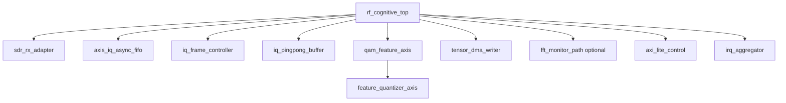

# RTL design plan

No RTL implementation is claimed in this phase. This document freezes module
responsibilities and verification boundaries before coding.

## Top-level block diagram



## Proposed Verilog modules

| Module | Important inputs | Important outputs | Responsibility |
|---|---|---|---|
| `rf_cognitive_top` | board clocks/resets, SDR pins, AXI masters/slaves | DDR AXI, IRQ, status | Integration only |
| `sdr_rx_adapter` | device-specific IQ/valid/clock | AXIS IQ32 | Isolate SDR electrical/protocol details |
| `axis_iq_async_fifo` | IQ AXIS in `sdr_rx_clk` | IQ AXIS in `pl_proc_clk` | CDC, overflow count |
| `iq_frame_controller` | IQ AXIS, enable, hop length | framed IQ AXIS, frame ID, timestamp | 1024-sample framing and optional overlap |
| `iq_pingpong_buffer` | framed IQ32 | tensor read port / DMA stream | Raw IQ A/B buffers |
| `qam_feature_axis` | IQ32, SOF/EOF | Power32, CorrRe33, CorrIm33, valid | Exact streaming physical features |
| `feature_quantizer_axis` | exact features, channel shifts/scales | three INT8 or INT16 channels | Round, saturate, saturation telemetry |
| `dc_remove_axis` | IQ32 | IQ32 | Optional/bypassed first release |
| `fir_iq_axis` | IQ32, coefficient RAM | filtered IQ32 | Optional/bypassed first release |
| `fft_monitor_path` | mirrored IQ32 | PSD bins/energy flags | UI/monitoring only |
| `tensor_dma_writer` | IQ/feature streams, DDR descriptors | AXI4 MM writes, done event | NPU tensor layout and ping-pong DMA |
| `axi_lite_control` | AXI4-Lite | configuration/status signals | Register bank |
| `irq_aggregator` | frame/DMA/error events | CPU IRQ | Masked sticky interrupts |

Recommended `qam_feature_axis` ports:

```text
input  wire         clk
input  wire         rst_n
input  wire [31:0]  s_axis_iq_tdata   // {Q[15:0], I[15:0]}
input  wire         s_axis_iq_tvalid
output wire         s_axis_iq_tready
input  wire         s_axis_iq_tlast
input  wire         s_axis_iq_tuser_sof
output wire [31:0]  m_power
output wire [32:0]  m_corr_re
output wire [32:0]  m_corr_im
output wire         m_valid
output wire         m_last
```

All signed ports, especially correlation outputs, must be declared explicitly
signed in the RTL implementation or cast at arithmetic boundaries.

## Clock and reset plan

- `sdr_rx_clk`: supplied/recovered by the chosen SDR interface.
- `pl_proc_clk`: feature/FIR/FFT pipeline clock; frequency is
  `TODO-HARDWARE` until timing synthesis.
- `axi_clk`: AXI DMA/control clock, selected from the board/PS clocking scheme.
- NPU and CPU clocks remain controlled by the vendor BSP/runtime.
- Cross SDR-to-PL with an AXIS asynchronous FIFO. Cross PL-to-AXI with another
  asynchronous FIFO if `pl_proc_clk != axi_clk`.
- Use active-low external reset only at the boundary. Synchronize reset
  deassertion separately in every clock domain using at least two flops.
- Reset clears previous-IQ registers, sample count, partial frame state,
  descriptor ownership and sticky overflow flags. Do not pass pulses directly
  across clock domains.

## AXI4-Lite register groups

Freeze addresses only when the BSP address map is available. Required semantic
registers are: version/capabilities, start/stop/soft-reset, bypass controls,
frame/hop length, IQ and feature quantization shifts, buffer addresses and
strides, frame ID/timestamp, DMA ownership, IRQ mask/status, FIFO overflow,
saturation counters and processed/dropped frame counters.

## Verification and development order

1. Export NumPy/PyTorch integer vectors for corner cases and random frames.
2. Implement `qam_feature_axis`; prove Power/Lag-1 bit-exact including minimum
   int16 values, SOF zero padding, stalls and backpressure.
3. Add quantizer; compare dequantized tensors and saturation counters with the
   Python deployment contract.
4. Verify frame controller and ping-pong ownership under random AXI stalls.
5. Integrate DMA and run DDR loopback without NPU.
6. Compile/run the partitioned ONNX graph on the vendor simulator/toolchain.
7. Connect FPGA buffers to NPU and validate logits against PC replay.
8. Add optional DC/FIR/FFT monitoring blocks one at a time.
9. Connect the real SDR, first by cable and attenuation, then controlled OTA.
10. Only after board measurement, record timing, utilization, latency, power,
    thermal and long-duration stability results.

Every stage has its own golden comparison; no stage advances merely because it
synthesizes.
